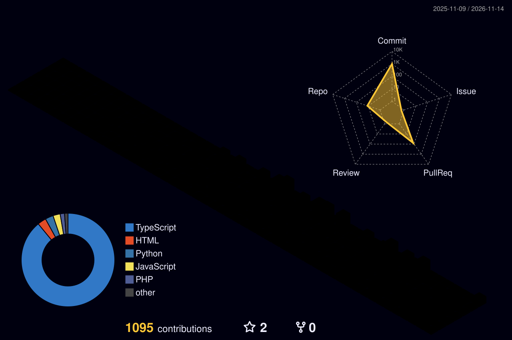

  

  
  
  
  
  

### Hi, I'm Kevin 👋

Full-stack developer from Colombia 🇨🇴 building e-commerce and SaaS products that **ship to production and actually sell**.

- 🏢 Software Developer at **Software Médico**
- 🚀 Founder of **[Brain Solutions](https://brainsol.vercel.app)** — custom web apps for LATAM businesses
- 🛒 Building and maintaining a production e-commerce with real traffic and real payments
- 🤖 Currently going deep on **RAG, AI agents and vector search** applied to commerce
- 🎓 Studying at Unidades Tecnológicas de Santander (UTS) · 🗣️ Spanish / English

> *I think in code, but also in users, funnels and revenue.*

### Stack

  

<b>Also comfortable with:</b> PHP · Laravel · Symfony · Python · Turborepo · Cloudinary · Wompi · Mercado Pago &nbsp;|&nbsp; <b>Exploring:</b> LangChain · embeddings · pgvector · LLM agents

### Selected work

  

<table>
  <tr>
    <td width="50%"></td>
    <td width="50%"></td>
  </tr>
  <tr>
    <td width="50%"></td>
    <td width="50%"></td>
  </tr>
  <tr>
    <td width="50%"></td>
    <td width="50%"></td>
  </tr>
</table>

### Activity

<picture>
  <source media="(prefers-color-scheme: dark)" srcset="https://raw.githubusercontent.com/kevinz-08/kevinz-08/output/profile-night-rainbow.svg" />
  <source media="(prefers-color-scheme: light)" srcset="https://raw.githubusercontent.com/kevinz-08/kevinz-08/output/profile-season.svg" />
  
</picture>

---

  Open to freelance projects and collaborations — <a href="mailto:kevingutierrez.dev@gmail.com">let's talk</a>.

